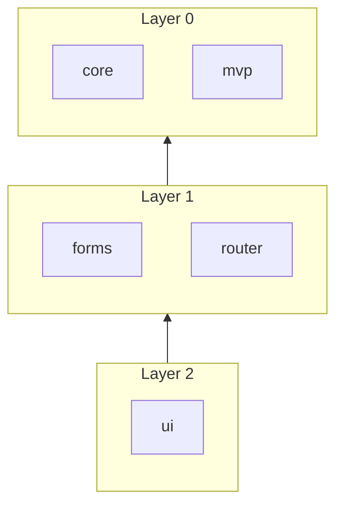

# Architecture

ngpel mirrors Archipel's package philosophy for the frontend: one npm package per vertical concern, a
zero-dependency `core`, dependencies that flow strictly downward, and subpath entry points where — and only
where — a caller would import one on its own. Packages are built with ng-packagr (partial-Ivy) so every
consumer's own Angular linker finishes the compilation.

## Layers

**Rule:** a package may import only packages of a _strictly lower_ layer. `core` and `mvp` import nothing
from ngpel. The rule is enforced by `@nx/enforce-module-boundaries` through the `layer:N` project tags.

## Entry points

A secondary entry point earns its place only when a consumer would import it on its own and would otherwise
pay for code it never uses. Everything else belongs in the package's primary entry point: `ui` keeps its
components, directives and pipes together and splits off only `./markdown` and `./widget`, `forms` publishes
a single entry point.

| Subpath       | Meaning                                                                                |
| ------------- | -------------------------------------------------------------------------------------- |
| `.`           | Primary entry. Framework-free where the concern allows it.                             |
| `./rx`        | RxJS-backed utilities (adds the `rxjs` peer).                                          |
| `./<concern>` | One tree-shakable concern of the package, for example `core/storage` or `ui/markdown`. |

There is no `./testing` entry point: ngpel ships no test doubles, and the helpers its own specs need live in
the spec that uses them. Only single-segment subpaths are allowed. All code lives under `libs/<pkg>/src/`; a
secondary entry point is a directory `libs/<pkg>/<entry>/` holding nothing but an `ng-package.json` whose
`entryFile` points at `../src/<entry>/index.ts`. ng-packagr derives the published `exports` map from these
marker directories, so `exports` is never hand-maintained; `typesVersions` is added afterwards by
`tools/postbuild-package.mjs` for consumers on `moduleResolution: node`.

## Optional peers

`@pixel-brewery/mosaik-elements-angular` and `-foundation`, `@angular/cdk` and the CodeMirror packages are
**optional peer dependencies of `ui`**: a consumer installs them only for the components that render through
them, and everything else in the workspace stays free of them. No other package may import Mosaik or
CodeMirror; `tools/postbuild-package.mjs` fails the build if one does, or if Mosaik is ever declared as a hard
dependency.

`@pixel-brewery/mosaik-themes` is different: it ships SCSS only. `ui` sets `inlineStyleLanguage: 'scss'` in its
`ng-package.json`, so the theme mixins a component uses are compiled into the published stylesheet and no
consumer has to install it.

## Composition convention

Every package with configuration exposes exactly one root provider from its primary entry:
`provide<Feature>(config?, ...features): EnvironmentProviders`. Optional capabilities are contributed by
`with<Option>()` factories that return `IFeature<TKind>` objects created through `createFeature()` from
`@pixel-brewery/ngpel-core`; `composeProviders()` validates kinds, ids and incompatibility rules.
The host package owns the kind vocabulary, the contributor owns the factory.
