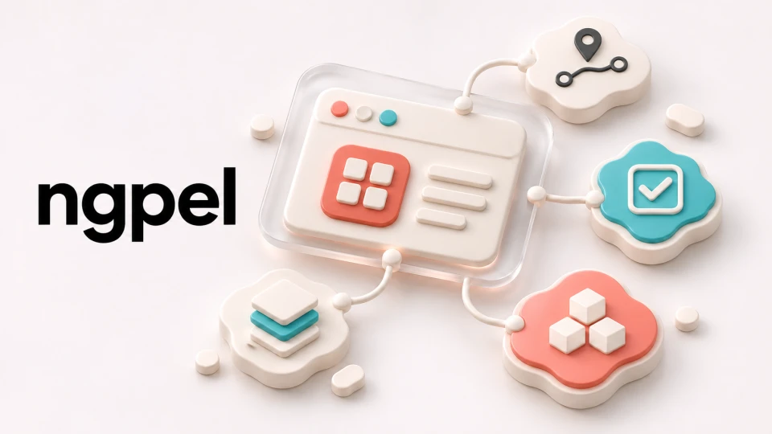

<p align="center">
  
</p>

# ngpel

**Build Angular applications on one shared foundation.**

ngpel brings recurring frontend work into five reusable Angular libraries. Compose browser services,
presenters, forms, routing and UI from the same building blocks across applications. ngpel is the
frontend companion to [Archipel](https://github.com/pixel-brewery/archipel).


[](https://github.com/pixel-brewery/ngpel/actions/workflows/ci.yml)
[](LICENSE)

[Get started](#get-started) · [Packages](#packages) · [Documentation](#documentation) · [Build from source](#build-from-source) · [Contribute](#contribute)

## Why ngpel exists

Angular applications often need the same mechanics for loading and commands, validating forms, keeping
view state in the URL and working with browser capabilities. ngpel gives those mechanics a shared
home so teams can use the same patterns while each application owns its views and product behavior.

- **Compose the features you need.** Provider functions register individual capabilities and let
  the application choose the adapters behind them.
- **Keep presentation logic reusable.** Presenters, commands and signals provide a common way to
  coordinate actions and expose state to views.
- **Import by concern.** Separate packages and subpath entry points let an application use the
  services it needs without bringing in the UI library.

## Get started

Use **Angular 22** and **TypeScript 6**. The source is MIT licensed. Packages are distributed through
**GitHub Packages** under `@pixel-brewery`, at `npm.pkg.github.com`. Installation requires a GitHub
personal access token (classic) with `read:packages`, including for public packages.

### Configure package access

For npm, add this to your application's `.npmrc`:

```ini
@pixel-brewery:registry=https://npm.pkg.github.com
//npm.pkg.github.com/:_authToken=${NODE_AUTH_TOKEN}
```

For Yarn 4, use `.yarnrc.yml`:

```yaml
npmScopes:
    pixel-brewery:
        npmRegistryServer: 'https://npm.pkg.github.com'
        npmAlwaysAuth: true
        npmAuthToken: '${NODE_AUTH_TOKEN}'
```

Set `NODE_AUTH_TOKEN` in your shell or CI, then install a package:

```sh
yarn add @pixel-brewery/ngpel-core
```

### Register a capability

For example, register the browser clipboard capability in your application configuration:

```ts
import type { ApplicationConfig } from '@angular/core';
import { provideBrowser, withClipboard } from '@pixel-brewery/ngpel-core/browser';

export const appConfig: ApplicationConfig = {
    providers: [provideBrowser(withClipboard())],
};
```

## Packages

| Package                                 | Layer | Capabilities                                                                                              |
| --------------------------------------- | ----- | --------------------------------------------------------------------------------------------------------- |
| [`ngpel-core`](libs/core/README.md)     | 0     | Feature composition, RxJS helpers, storage, browser, notifications, audio, search and the operation queue |
| [`ngpel-mvp`](libs/mvp/README.md)       | 0     | Model–View–Presenter, commands, presenter behaviors and controllers                                       |
| [`ngpel-forms`](libs/forms/README.md)   | 1     | Signal Forms validators, status classes and password strength                                             |
| [`ngpel-router`](libs/router/README.md) | 1     | Route paths, URL signals, navigation and application shell                                                |
| [`ngpel-ui`](libs/ui/README.md)         | 2     | Components, directives, pipes, Markdown and widgets                                                       |

Each package README documents its import options and peer dependencies. See the
[package catalog](.docs/packages/index.md) for the full overview.

## Documentation

Browse the [documentation website](https://pixel-brewery.github.io/ngpel/) or read the guides
alongside the source:

- [Getting started](.docs/guides/index.md) — package access and application setup
- [Patterns](.docs/patterns/index.md) — presenters, commands and provider composition
- [API reference](.docs/api/index.md) — generated reference by package
- [Architecture](.docs/architecture/index.md) — package layers and entry points
- [Release guide](.docs/guides/releases.md) — fixed versions, publication and verification

## Build from source

Use a Node.js version supported by Angular 22 (22.22.3 or later on 22.x, 24.15.0 or later on
24.x, or 26 and later) and the workspace's pinned Yarn 4.10.3. Configure registry access as above,
then run:

```sh
git clone https://github.com/pixel-brewery/ngpel.git
cd ngpel
corepack enable
yarn install --immutable
yarn run verify
```

Verification checks contributor guidance, public source, formatting, workflow tooling,
lint, tests, spelling, generated API docs and the built ESM packages.

For focused work, use the owning Nx project. The consumer fixture builds an Angular application
against the packed libraries.

```sh
yarn nx run core:test
yarn nx run fixture-ng22:build
yarn docs:dev
```

## Contribute

Read the [repository engineering guide](AGENTS.md) for source conventions and verification. Use
Conventional Commits and open a pull request. Package publication is a separate maintainer step
after CI has verified the release revision.

## License

[MIT](LICENSE).
